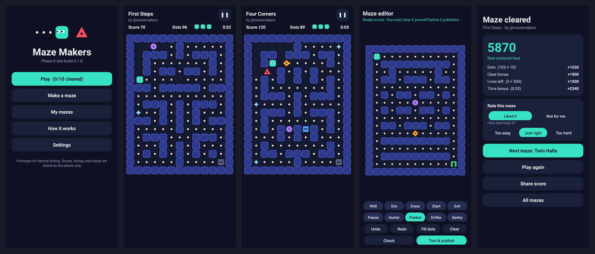

# Maze Makers: Android test build

A playable prototype of Phase 0 from [PRD v0.2](../docs/maze-makers/PRD.md). It's for internal testing only: everything is stored on the phone, and there's no server, accounts or community feed.

## Install the APK

1. Copy `dist/maze-makers-0.1.0.apk` to an Android 10 or newer phone.
2. Open it and allow "Install unknown apps" for whichever app you opened it from (Files, Chrome, Drive).
3. Launch **Maze Makers**. The launcher shows the default Android icon because this build has no icon yet.

The APK is signed with a throwaway test key. If you rebuild on another machine, a new key is generated, so uninstall the old build before installing the new one.



## What's in it

| PRD item | In this build |
|----------|---------------|
| C-01 to C-03 deterministic core | `core/` is plain Java with fixed ticks, integer movement and a seeded generator. The same code runs on the phone and in host tests. |
| C-06 determinism test | `test/CoreTest.java` replays fixed input scripts and compares state hashes. |
| G-01 to G-03 | Swipe to move. Eat every dot to open the exit, then reach it. 3 lives. |
| G-02 enemies | Hunter (shortest path), Flanker (cuts you off), Drifter (random), Sentry (patrols a line). Each has a distinct shape, so none relies on color alone. |
| G-04 score | One published formula for every maze. See "How it works" in the app. |
| G-05 Freeze | The ice star stops every enemy for 3 seconds. |
| G-06 pause | Back button or the pause icon. The maze is hidden while paused. |
| G-07 tutorial | Shown the first time you play maze 1. |
| G-09 assist mode | Settings. Slower enemies, 4 lives, never counted toward best scores. |
| Launch content | 10 curated mazes across 5 tiers. |
| E-01 to E-08 editor | Ten tile types, undo and redo, draft autosave, validation, a solver bot difficulty estimate, and a clear check (you must beat your own maze before it publishes). |
| E-09 versions | "Edit as new version" publishes a new maze and leaves the old one untouched. |
| M-03, M-04 title filter | Local stand in: allowed character set, a small blocklist, no links or handles. |
| Core loop step 4 | Rate each maze (liked or not, plus a difficulty vote). Share a score through Android's share sheet. |

**Not in this build:** accounts, the server, leaderboards beyond your own best score, community feeds, reporting, the Phase 0 attribution A/B test, analytics, and an app icon.

## What testing has already shown

* **Solver vs human difficulty (PRD M-08).** The bot rates most of the curated mazes "Easy" even where they were designed as tier 4 or 5. The bot reacts instantly and never panics, so its clear rate overstates how easy a maze is for a person. Expect the PRD's "large gap between solver and player difficulty" review trigger to fire a lot until the bot gets human-like reaction delays. Collect the in-app difficulty votes from testers to calibrate it.
* **Dots in a patrol shaft are a trap.** Twin Halls (tier 1) had two dots inside the Sentry's dead end patrol corridor. The bot stalled there in 48 of 300 runs. A careful player can grab them, but it's a mean trick for a beginner maze, so the dots were moved. The build now fails if the bot stalls on any curated maze, which catches this class of trap automatically. The editor should get the same check before community mazes ship.
* **Dead end mazes are unfair.** The first versions of The Spiral and Gauntlet had long single lane dead ends, and the bot lost every run. With a Hunter behind you, a dead end is a guaranteed lost life. Both were redesigned with escape loops. A "no long dead ends" rule may belong in the editor's validation.

## Build it yourself

```bash
cd app
./build.sh          # core tests, compile, dex, manifest, package, sign, verify
```

Needs JDK 17+, python3 and curl. No Android SDK is required: the build downloads android.jar (compile only), D8 and apksig, and writes the binary manifest itself (`tools/axml.py`), because aapt2 wasn't reachable from the environment this was built in. With a normal Android SDK you'd swap this for a Gradle project; the code doesn't change.

## Smoke test

```bash
cd app/smoketest
./run.sh            # screenshots land in target/screens
```

Runs the real app code under Robolectric (Android 14 framework on the JVM). It taps through every screen, plays every curated maze to the end with the solver bot driving the real game view, builds, clear checks, publishes, edits and deletes a maze in the editor, and checks the title filter, assist mode and pause behavior.

## Layout

```
app/
  src/com/ukkuru/mazemakers/core/   shared simulation: Maze, Sim, Rng, Validator, Bot, Levels
  src/com/ukkuru/mazemakers/        Android UI: MainActivity, GameView, EditorView, Store, Ui
  test/CoreTest.java                host tests for the core
  tools/                            manifest writer, signer, javac stub
  smoketest/                        Robolectric end to end test
```
